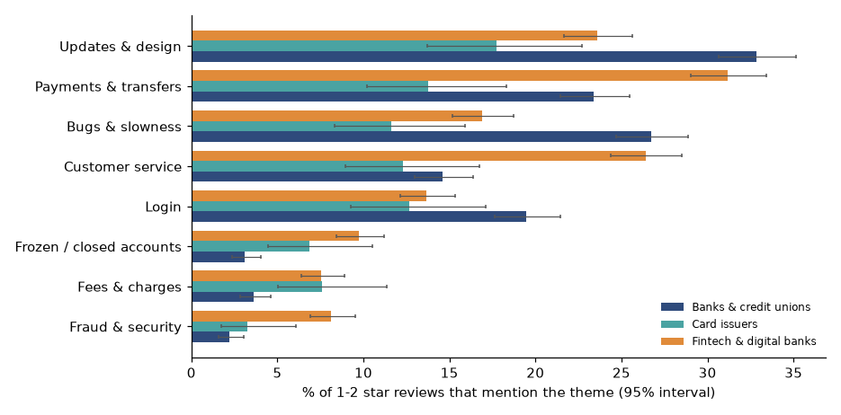
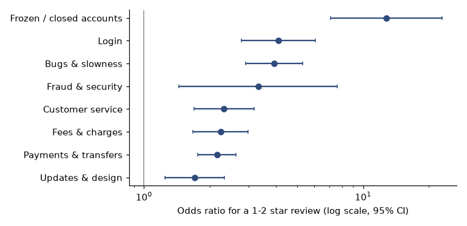

# Bank app reviews: what should a bank fix first?

**For:** a head of digital product or customer experience at a bank.
**Data:** the 500 most recent App Store (US, iOS) reviews of 17 bank, card and fintech apps, collected 2026-10-26 (8,350 reviews). Reviewer names and IDs were never stored, and review text is not in this repo.

## Answer
- **Most unhappy reviewers write about the app working or changing.** At banks and credit unions, **37%** of 1 and 2 star reviews mention login or bugs, and **59%** mention login, bugs or a redesign or update.
- **Common is not the same as costly.** Updates and design are the most frequent theme but have the weakest link to a low rating (odds ratio 1.7). **Frozen or closed accounts** are rare at banks (3%) but the strongest (odds ratio **12.8**); login (4.1) and bugs (3.9) are common and strongly linked.
- **Fintech and payment apps have a different problem.** Their unhappy reviewers mention frozen or closed accounts **2.7 times** and fraud or security **3.5 times** as often as bank and card-issuer reviewers, and the gap holds when any one app is left out.
- **Average rating can't rank these apps.** Mean rating of recent reviews runs from 1.6 to 4.8 stars, but it tracks how many short five-star reviews an app collects (correlation 0.99 with its five-star share), which depends on how often it prompts happy users.



## What this analysis does
- **Respects the sample.** The 500 most recent reviews cover 3 days for one app and 282 days for another, so the main analysis uses only 1 and 2 star reviews, whose authors write spontaneously.
- **Validates its own tagger.** Nine themes are tagged by transparent keyword rules, checked against 200 hand-labeled reviews, rewritten after error analysis, and scored once on a fresh sample of 200 (median precision 0.75, recall 0.71). Labels were made by an AI, not a second human.
- **Separates frequency from cost.** A logistic regression with a baseline per app shows which themes go with low ratings.
- **Checks robustness.** The fintech gap is recomputed on longer reviews and with each fintech app left out in turn.



## Files
- [research_plan.md](research_plan.md): plan, data check, one amendment made after seeing the sampling problem, and predictions
- [notebooks/bank_app_reviews.ipynb](notebooks/bank_app_reviews.ipynb): the full analysis, executed
- [src/collect.py](src/collect.py): polite collector (names and IDs dropped at ingestion); [src/themes.py](src/themes.py): the tagging rules; [src/reviews.py](src/reviews.py): helpers
- [app/app.py](app/app.py): Streamlit explorer (aggregated results only)

## Run it
```
pip install -r ../requirements.txt
python src/collect.py              # collects a new snapshot; results will differ from the one analyzed here
jupyter nbconvert --execute --to notebook --inplace notebooks/bank_app_reviews.ipynb
streamlit run app/app.py
```
The executed notebook is the record of the 2026-10-26 snapshot; a new collection returns different reviews.

## Data note
Reviews come from Apple's public customer-review feed. The raw review text is kept local and is not committed; the repo holds aggregated tables and the hand labels (theme codes only).

## Limits
iOS only; each app's 500 most recent reviews, covering very different time windows; reviewers are self-selected; the tagger is rule-based with moderate accuracy, and its validation labels were made by an AI; odds ratios describe association, not the effect of a fix; per-app results are noisy (U.S. Bank and Truist have fewer than 50 unhappy reviews); app reviews describe the app, not the bank's overall service.
