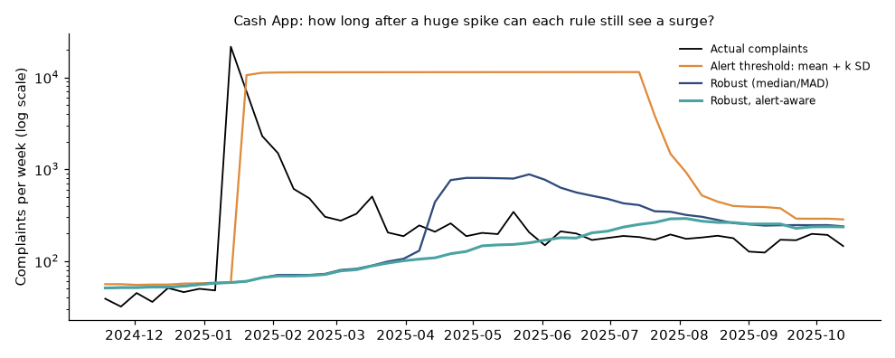
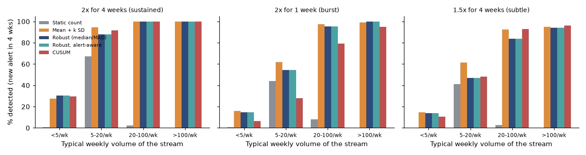

# Complaint monitor: which streams need escalating this week?

**For:** a head of complaint management at a large US bank or payments firm.
**Data:** CFPB Consumer Complaint Database (18.7M complaints to October 2026). Scoped to six bank product groups, 2018 onward, complete weeks only: 1.39M complaints in 250 company-by-product streams.

## Answer
- **Run a robust, alert-aware rule.** Alert when a week exceeds the median of the previous 26 weeks by 2.5 robust standard deviations and at least 5 complaints, with flagged weeks capped when they enter the baseline. It opens about **6 new alert episodes a week** across all streams.
- **It catches real surges in big and mid-size streams.** For streams above 20 complaints a week, a 2x surge lasting 4 weeks is detected 100% of the time and a 2x one-week burst 96% (a new alert within 4 weeks of onset).
- **Baseline design matters most after a huge spike.** After the January 2025 Cash App wave (21,608 complaints in one week against a normal 40 to 50), the standard "mean + k standard deviations" rule needed about **11,000 complaints a week** to alert, for 26 weeks. The alert-aware rule needed 109 to 251.
- **Streams under 5 complaints a week can't be monitored alone** (114 of 250 streams; surges detected 14% to 30% of the time). They need rolling up.
- **70% of alert episodes are bursts** that fade within 3 weeks. The triage fields (issue concentration, web share, persistence) help tell a coordinated filing wave from a broad service problem.



## What this analysis does
- **Data hygiene:** product names changed in 2017 and 2023 and are mapped to six stable groups; credit bureaus, student loans and debt collection are excluded; the newest two weeks in the file are dropped because publication lags receipt.
- **Five detectors compared at equal analyst workload** (static count, mean + SD, robust, robust alert-aware, CUSUM).
- **Back-test with injected surges** of known size, by stream volume, counting only a **new alert** as detection.
- **Baseline contamination test** on the real Cash App and Zelle spikes.
- **Alert triage** with issue concentration, channel mix, and burst vs sustained.
- **A weekly workload check:** the last 52 weeks ran at 7.1 new episodes a week (target 6), with 11 weeks above 10, so a production monitor needs a cap and periodic re-tuning.



## Files
- [research_plan.md](research_plan.md): scope, method and predictions, written before building
- [notebooks/complaint_monitor.ipynb](notebooks/complaint_monitor.ipynb): the full analysis, executed
- [src/monitor.py](src/monitor.py): stream construction, detectors, injection back-test, triage
- [app/app.py](app/app.py): Streamlit monitor with adjustable sensitivity and a per-stream threshold chart

## Run it
```
pip install -r ../requirements.txt
# download complaints.csv.zip from the CFPB (see data note) into data/raw/, then build the parquet used by the notebook: python src/prepare_data.py
jupyter nbconvert --execute --to notebook --inplace notebooks/complaint_monitor.ipynb
streamlit run app/app.py
```

## Data note
CFPB Consumer Complaint Database bulk file (`https://files.consumerfinance.gov/ccdb/complaints.csv.zip`), downloaded 2026-10-26. The raw file is not included. Check the CFPB's terms of use before redistributing derived data.

## Limits
Detection is measured on injected surges because the data has no incident labels. Complaints are unverified and reflect awareness and campaigns as well as service quality. No normalization by company size. The stream list uses whole-period totals (a mild look-ahead). Acknowledge-and-rebaseline and roll-up of small streams are not built.
