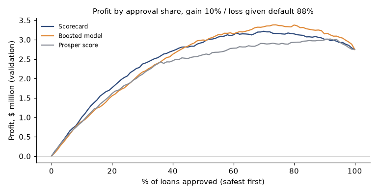
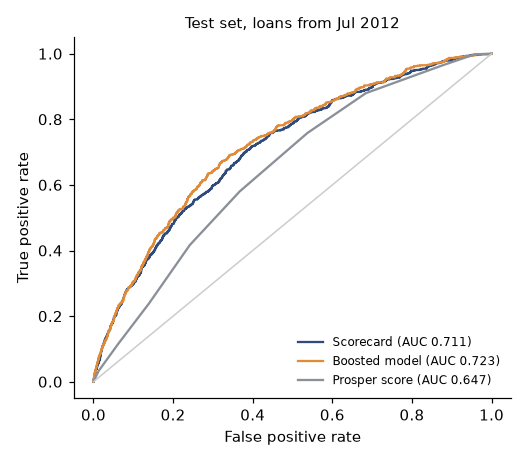

# Credit risk: which applicants should a lender approve, and at what cut-off?

**For:** a head of consumer credit.
**Data:** 113,937 Prosper peer-to-peer loans (2005 to 2014). The model uses the 40,924 loans originated after the July 2009 relaunch that had a full 12-month outcome window. "Bad" = charged off or defaulted within 12 months.

## Answer
- **Use an explainable scorecard.** On loans it had never seen (originated Jul 2012 to Mar 2013) it ranks risk better than Prosper's own score: AUC **0.711 vs 0.647** (difference +0.064, 95% CI +0.042 to +0.083). A boosted model adds +0.012 (CI −0.001 to +0.023), not distinguishable from zero.
- **Set the cut-off by cost.** A bad loan loses 88% of principal (measured); a good loan earns an assumed 10%. At those assumptions, approving the safest 76% of loans lowers the bad rate from 6.1% to 3.9% and earns **$0.39M more** than approving everyone (95% CI $0.18M to $0.59M) on $104M of test-set loans, with 24% fewer loans approved. Declined loans went bad 13.2% of the time.
- **The optimum is flat.** Profit stays within a few percent of its maximum from about 60% to 85% approval, so the key decision is declining the riskiest quarter or so of applicants, not the exact cut-off.
- **The margin assumption matters more than the model.** Across plausible gains and losses the best approval share ranges from 30% to 96%. The bank's own numbers should replace mine; the app lets you do that.



## What this analysis does
- **Right-censoring.** Recent loans have not had time to default; labeling them "good" would make them look safe. Only loans with a complete 12-month window are used.
- **Time-based split** (train 2009 to 2011, validate H1 2012, test Jul 2012 to Mar 2013), not random.
- **Scorecard vs boosted model vs the platform's own score,** with bootstrap intervals on the differences.
- **Calibration, not just ranking:** both models over-predict the test bad rate (9% and 15%), because bad rates drifted down; recalibration on validation barely helps.
- **Stability:** score PSI 0.05 to 0.08; loan size drifted sharply (PSI above 0.9) without hurting ranking.
- **Leakage check:** a model given post-origination fields reaches AUC 0.99, which is why they are excluded.
- **Reason codes** for declined applicants.
- **Selection problem stated up front:** only funded loans are observed.



## Files
- [research_plan.md](research_plan.md): the plan, target definition and predictions, written before modeling
- [notebooks/credit_risk_prosper.ipynb](notebooks/credit_risk_prosper.ipynb): the full analysis, executed
- [src/credit.py](src/credit.py): cohort prep, weight-of-evidence scorecard, metrics, profit curve
- [app/app.py](app/app.py): Streamlit cut-off simulator with editable cost assumptions

## Run it
```
pip install -r ../requirements.txt
# put the Prosper loan file at data/raw/prosper_loans.csv (see data note)
jupyter nbconvert --execute --to notebook --inplace notebooks/credit_risk_prosper.ipynb
streamlit run app/app.py
```

## Data note
The file is the public Prosper loan dataset (`prosperLoanData.csv`, also on Kaggle as [henryokam/prosper-loan-data](https://www.kaggle.com/datasets/henryokam/prosper-loan-data)). The raw file is not included in this repo.

## Limits
Funded loans only (no rejected applicants, so this is not a complete underwriting policy); the 10% gain is an assumption; the 12-month horizon captures early default only; a 2009 to 2013 peer-to-peer platform is not a bank's population; no fairness testing is possible because the data has no protected-class fields.
