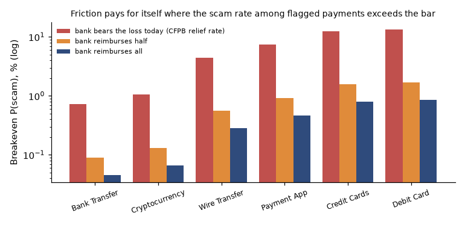
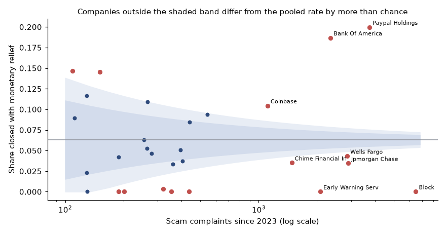

# Scam losses: where do they concentrate, and where should a bank add friction?

**For:** a head of fraud strategy at a large US bank.
**Data:** FTC Consumer Sentinel Data Books 2019 to 2024 (aggregate tables parsed from the published PDFs), US Census population estimates, and the CFPB Consumer Complaint Database (record level). Both fraud sources are unverified consumer reports that cover only a fraction of scams.

## Answer
- **A few large losses are most of the money.** In 2024, 12.6% of loss reports exceeded $10,000 and held at least **87.6%** of the $12.5 billion reported. The median loss was $497; the mean was 25 times larger. Reported losses per resident are **6.4 times** their 2019 level.
- **Bank transfers and crypto dominate the dollars:** with wires, **70%** of classified payment-method losses in 2024. A bank-transfer report carries about **$44,000** in losses, 17 times a credit-card report.
- **Total and typical loss rank channels differently:** social media has the highest total ($1.86B) but a median of $409; phone calls have the highest median ($1,500).
- **Banks rarely reimburse scam victims, and they differ widely.** Only **6.3%** of CFPB scam complaints ended with monetary relief and 89.7% with an explanation only. Company rates range from 0% to 20%; 15 of 29 companies with 100+ complaints fall outside what chance would produce.
- **Friction pays where loss per scam is high, and who bears the loss decides how much.** For bank transfers (25% effective, $5 per flagged payment), friction breaks even at about 1 flagged payment in 140 being a scam if the bank bears only today's 6.3% of losses, but at about 1 in 2,200 if the bank reimburses in full: a 16-fold difference.



## What this analysis does
- **Loss distributions:** medians beside means, and a rigorous lower bound on the dollar share held by the largest losses from the published loss bands.
- **Normalized and compared over time:** per 100,000 residents; payment method and contact method shares for 2020 to 2024.
- **Complaint handling by company:** relief and timeliness for scam complaints, Wilson intervals and a funnel plot against the pooled rate, with the self-selection caveat stated.
- **A friction decision model** that solves for the breakeven scam rate by payment type, effectiveness, cost and the share of loss the bank bears.



## Files
- [research_plan.md](research_plan.md): plan, data check and predictions, written before the analysis
- [notebooks/scam_losses.ipynb](notebooks/scam_losses.ipynb): the full analysis, executed
- [src/ftc.py](src/ftc.py): parser for the FTC Data Book tables; [src/scam.py](src/scam.py): bounds, funnel limits, breakeven
- [app/app.py](app/app.py): Streamlit friction calculator with the FTC explorer and company response table

## Run it
```
pip install -r ../requirements.txt
python src/download_sources.py     # FTC data books and Census tables
python src/ftc.py                  # parse the FTC tables
# the CFPB section needs the complaint parquet: see ../complaints (python src/prepare_data.py)
jupyter nbconvert --execute --to notebook --inplace notebooks/scam_losses.ipynb
streamlit run app/app.py
```

## Data note
FTC data books are US government publications; the FTC publishes them as PDFs and an interactive dashboard only. The 2025 edition could not be located, so the latest year is 2024. Check the CFPB's terms of use before redistributing derived data. Raw files are not included in this repo.

## Limits
Unverified consumer reports in both sources; payment method is classified for about 18% of FTC fraud reports and contact method for 58%; the FTC tables have no payment-method median; CFPB scam tagging exists only for the money transfer product; company comparisons are among complainers; the friction model gives breakeven thresholds, not forecasts, and values only losses the bank bears.
